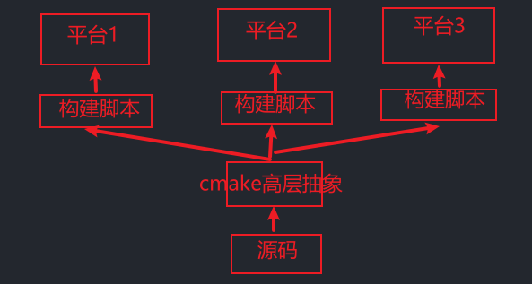

# CMake

CMake 是一个 跨平台的构建工具，可以根据不同的平台、不同的编译器，生成相应的构建文件



源文件想要在各个平台各个编译器运行：

* 考虑没有cmake的情况：需要考虑低级构建脚本的差异
* 考虑用cmake的情况：通过高层抽象cmake，将它编译成特定平台的低级构建脚本（Makefile 、.vcxproj、bat、.sh）

### CmakeLists.txt配置文件

CMakeLists.txt主构建脚本

```c++
//基础
cmake_minimum_required(VERSION xxx FATAL_ERROR)//指定最低版本，FATAL_ERROR（可选）如果 CMake 版本低于 3.19，配置过程将立即终止并报错
project(xxx VERSION xxx)//项目名称，项目版本

//CMAKE_开头的都是内置变量
set(CMAKE_CXX_STANDARD 17) //C++标准：11, 14, 17, 20, 23
set(CMAKE_CXX_STANDARD_REQUIRED ON)//如果不支持C++标准会报错
set(BUILD_SHARED_LIBS OFF)//OFF将所有库构建为静态库，ON将所有库构建为动态库，适用于add_library()但没有显式指定库类型的目标
set(CMAKE_EXPORT_COMPILE_COMMANDS ON )//生成compile_commands.json文件
set(CMAKE_BUILD_TYPE Debug) //编译类型（Debug/Release）

// 创建自定义变量（实际使用的是变量的值）
set(TARGET_NAME "MyApp")           // 字符串变量
set(SOURCE_FILES "main.cpp")       // 字符串变量  
set(FLAG_VALUES ON OFF TRUE FALSE CACHE BOOL "" FORCE) // 布尔变量, 将变量存入缓存以便在多次配置间保持，变量类型，描述，强制覆盖（即使缓存中已存在该变量也强制设置为新值）
set(LIST_VAR item1 item2 item3)    // 列表变量

// cmake内置
CMAKE_CURRENT_SOURCE_DIR // cmake当前目录
CMAKE_SOURCE_DIR  // cmake根目录（根cmake的目录）
CMAKE_INSTALL_PREFIX // cmake安装目录
CMAKE_CXX_COMPILER_ID    // 编译器标识（MSVC/GNU/Clang等）
WIN32 、 UNIX 、 APPLE // 平台检测变量： Windows 平台 、 Unix-like 平台（包括 Linux 和 macOS）、macOS 平台

//条件判断
if(PROJECT_SOURCE_DIR STREQUAL PROJECT_BINARY_DIR)//STREQUAL ==
elseif()
else()
endif()

//打印 级别 消息
message(FATAL_ERROR "xxx")

//自定义选项
option(<variable> "<help_text>" [initial_value]) // 创建用户可以配置的布尔选项，variable自定义选项名，help_text描述文本，initial_value初始值默认为OFF，
if(variable) // 使用
endif()
cmake -variable=ON .. //可以命令行启用

add_dependencies(xxx xxxx) // 建立目标间依赖关系，确保xxx一个目标在xxxx另一个目标之后构建

add_subdirectory(xxx)//添加子目录, 表示引入了xxx文件夹下的CMakeLists.txt

find_package(OpenGL REQUIRED)//查找包

source_group(TREE "${xxx}" FILES ${xxxx}) // 创建虚拟文件夹，以便让文件按目录结构显示，而不是平铺列表，TREE指定目录结构，FILES指定哪些文件列表被组织

// 选项
add_compile_options("/MP") // 为所有目标添加编译（编译器使用）选项, /MP为MSVC特有的并行编译
target_compile_options(${xxx} PUBLIC "$<$<condition:xxxx>") //为目标添加编译选项, - 表示"启用"，没有 - 表示"禁用"
option(<variable> "<description>" [initial_value]) // 创建/修改现有 布尔选项，可以在cmakelists中使用，也可以让用户控制

// 设置target目标 属性
set_property(DIRECTORY ${xxxx} PROPERTY VS_STARTUP_PROJECT xxx) // 设置属性, DIRECTORY指定作用范围, PROPERTY指定属性类型 xxxx：VS_STARTUP_PROJECT默认启动项目 xxx,这样f5运行时默认启动xxx
set_target_properties(${xxx} PROPERTIES CXX_STANDARD 17 OUTPUT_NAME "xxxx" FOLDER "xxxxx") // 设置xxx目标 C++17 标准，可执行文件名为 xxxx，虚拟文件夹 名为xxxxx

add_compile_definitions("xxx=${xxx}") // 预处理器宏，编译时被替换到源代码中

// 附加：目标列表，要添加的元素
list(APPEND ALL_GENERATED_SPV_FILES ${SPV_FILE})

//文件搜索语法
set(SOURCES
    src/main.cpp
    src/utils.cpp
    src/glfw_window.cpp
)
file( {GLOB | GLOB_RECURSE递归查找}  <variable> [CONFIGURE_DEPENDS] <globbing-expressions>) // 收集文件列表,variable自定义名称，CONFIGURE_DEPENDS当文件变化时自动重新运行CMake，globbing-expressions匹配的路径

//包含文件
include(xxx)//包含模块，加载CMake的依赖选项模块，该模块提供了 cmake_dependent_option() 命令
include_directories(//为当前目录及所有子目录的所有目标添加包含目录
    include/
    third_party/glfw/include
)
target_include_directories(target <INTERFACE|PUBLIC|PRIVATE> [items...])//为特定目标添加包含目录
// 目标：构建目标(exe / 库) / add_custom_target自定义的目标
// 可见性修饰符：
// PUBLIC：既用于编译目标本身，也传递给依赖它的其他目标
// PRIVATE：仅用于编译目标本身
// INTERFACE：不用于编译目标本身，但传递给依赖它的其他目标
// $<BUILD_INTERFACE:...>：编译时的搜索路径
// $<INSTALL_INTERFACE:...>: 安装后的搜索路径

//构建目标(exe / 库)
add_executable(xxx ${xxxx})//可执行文件，xxx为可执行文件名，xxxx为源文件
add_library(xxx [STATIC | SHARED | MODULE] ${xxxx})//库文件（要构建的库），静态库、动态库、接口库
add_custom_target(目标名称, DEPENDS依赖文件列表，SOURCES目标源文件列表)

//链接库
target_link_libraries(<target> [PRIVATE | PUBLIC | INTERFACE] <libs>...)// 建立链接关系

//安装目标，xxx为可执行文件名
install(TARGETS xxx
    RUNTIME DESTINATION bin
    LIBRARY DESTINATION lib
    ARCHIVE DESTINATION lib
)
```

### 生成工程、构建运行
  
* 生成工程
  * 命令行方式

    ```c++
    mkdir build//创建文件夹build
    cd build//进入文件夹
    cmake .. -G "Visual Studio 17 2022" -A x64 // -G指定编译器（可选。否则使用默认编译器），指定CmakeLists.txt所在目录
    ```

    * 构建工程文件
  * GUI方式
    * 选择源码目录
    * 选择输出目录
    * 点击Configure，选择要构建的目标，等待配置，done……，生成Makefile
    * 点击Generate，done……，生成工程文件

```c++
cmake --build .//构建项目
Main.exe//运行可执行文件
```
  
* 命令行编译运行
* 调试：自动生成pdb
* 多文件：在CmakeLists.txt中，可以使用file(GLOB_RECURSE SOURCES "src/*.cpp")多源文件编译操作
* 使用库：

### cmake脚本文件

*.cmake脚本文件

```c++
// 定义函数
function(funcname parameter0 parameter1……)
  //funcbody
endfunction()

// 定义宏
macro(setup_target TARGET_NAME)
endmacro()

// 自定义命令
add_custom_command(OUTPUT输出文件，COMMAND执行的命令，DEPENDS依赖文件，WORKING_DIRECTORY工作目录)

//使用方式
include(…….cmake) // 路径
funcname() // 函数调用
```